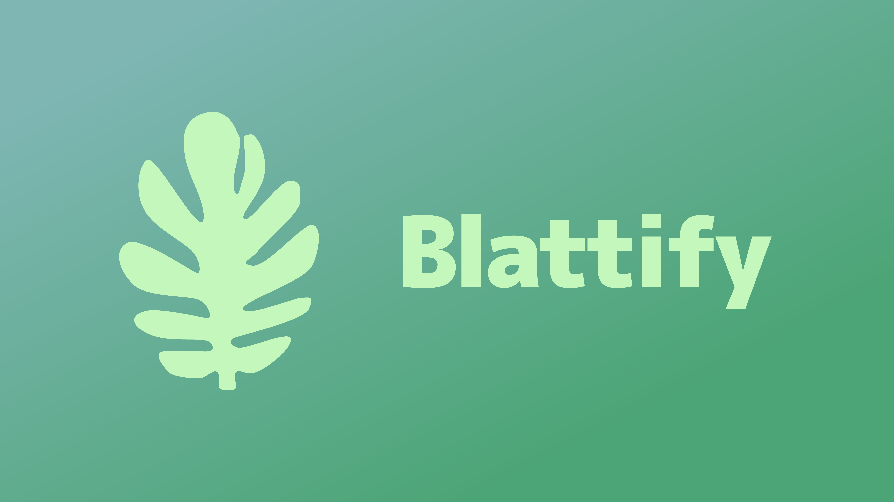
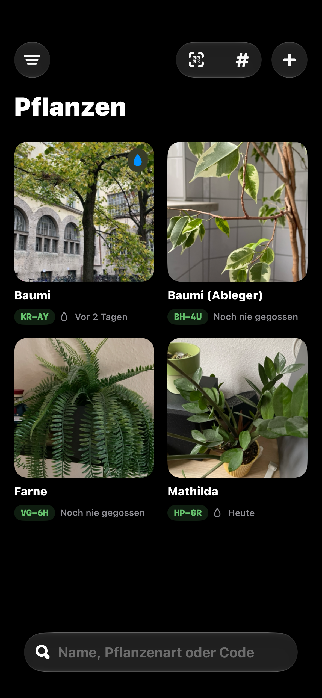
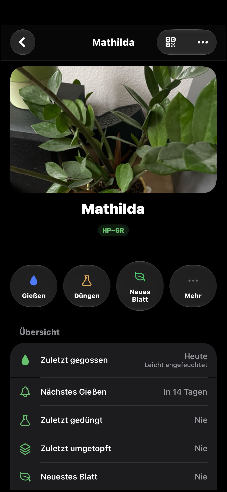
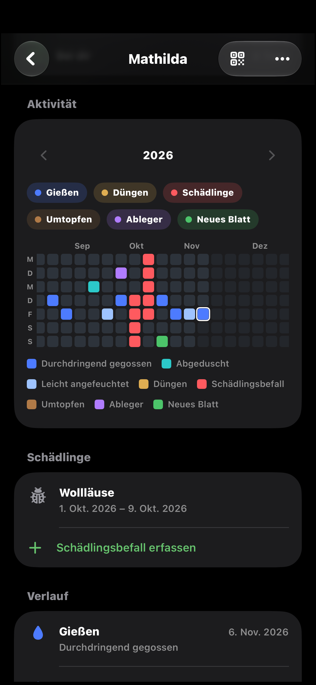
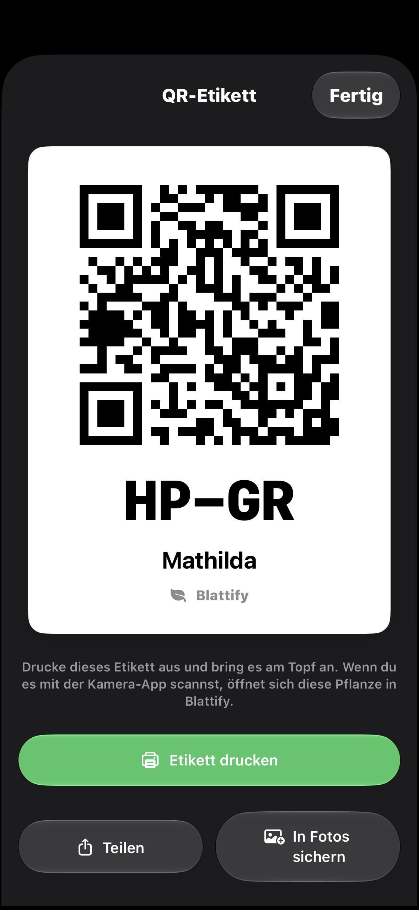

  

  <b>Keep track of your houseplants – with a QR label on every pot.</b>

  
  
  
  
  

  
  
  
  

## Features

- 🏷️ **QR labels** – every plant gets a short code like `HP-GR`; scan it with the Camera app to open the plant
- 💧 **Care log** – watering (soaked, moistened, shower), fertilizing, repotting, cuttings and new leaves, with notes and photos
- 🟩 **Activity matrix** – a GitHub-style yearly overview of all care events
- 🐞 **Pests** – track infestations from first sighting to resolved
- 🌱 **Cuttings** – create a new plant from a cutting and see the family tree
- 🔔 **Reminders** – per-plant watering intervals with notifications
- 🖨️ **Label printer** – print code + QR directly on a P22 Bluetooth label printer
- ☁️ **iCloud sync** and `.blattify` backups for export and import

## Getting started

1. Open `Blattify.xcodeproj` in Xcode.
2. Select your development team and an iCloud container for the `Blattify` target.
3. Build and run on an iPhone with iOS 26 or later.

Tests use Swift Testing and run from the `BlattifyTests` scheme.
